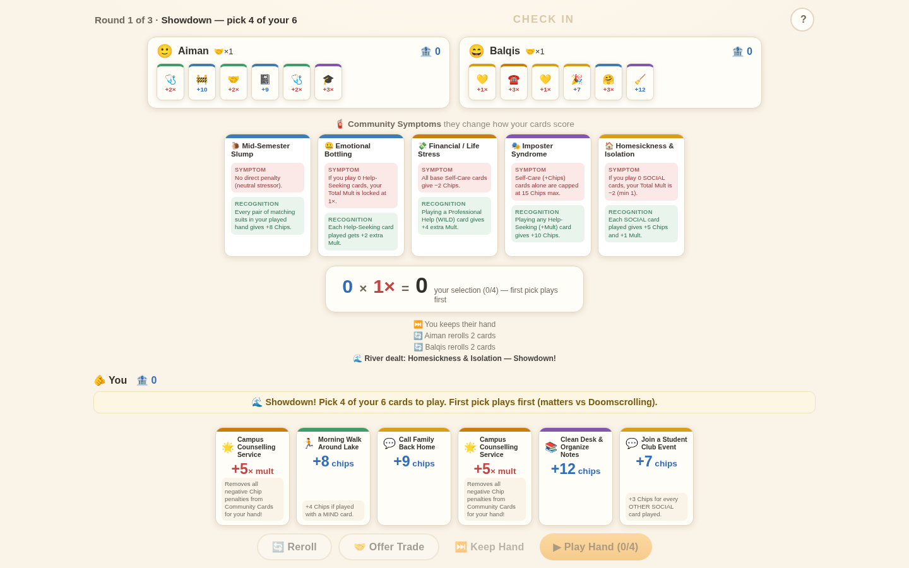

# 🃏 Check In — a coping card game

A Texas Hold'em-inspired card game with **no gambling**: chips are pure score,
every card is face-up, and the winning strategy is pairing self-care with
help-seeking. Built as the playable digital prototype for the **TLIG Board Game
2026** competition (Mental Health Toolkit 2.0, University of Nottingham
Malaysia) — the brief calls for a physical game; this demo validates the rules
and lives in the proposal as a playable link. One card database
(`js/data/cards.js`) will drive both the web demo and the printed deck.



**1 human vs 2 AI classmates · 3 rounds · ~6 minutes · zero installs.**

---

## ▶ Play it right now

Double-click **`index.html`**. That's it — no build step, no server, no
dependencies (the game deliberately uses classic `<script>` tags instead of ES
modules so it runs straight from `file://`).

To host it: push to GitHub and enable GitHub Pages (see
**[PUSH_TO_GITHUB.md](PUSH_TO_GITHUB.md)**, ~3 commands).

## 🧠 The idea in 30 seconds

| | |
|---|---|
| **The board** | 5 shared **Symptom cards** deal like a poker board (flop 3 → turn 1 → river 1). Each one *debuffs* some plays and *rewards* the coping strategies that actually fit it. |
| **Your toolkit** | 6 face-up cards. **Self-Care** cards bank **Chips** (🟦). **Help-Seeking** cards add **Multipliers** (🟥). |
| **The score** | `Chips × Mult` — Balatro math, not poker hands. Self-care alone caps your recovery; reaching out multiplies it. |
| **The twist** | Trading a card with a classmate gives **both players +2 Mult**. In this game, helping someone literally multiplies your own score. |

## 📜 Full rules

**Game shape:** 3 rounds; each round is deal → action → turn → action →
river → showdown. Highest chip bank after round 3 wins. Ties share the rank.

**Each action phase (one action per player):**
- 🔄 **Reroll** — discard & redraw up to 2 cards
- 🤝 **Offer Trade** — swap one card with any player. *Both* traders bank
  +2 Mult for the round (stacks to +4). Initiating spends your action;
  **accepting an incoming trade is free** — accepting help never costs you.
- ⏭️ **Keep Hand** — pass

**Showdown:** pick 4 of your 6 cards (order matters — see S08 below) and
play them. Score = `Total Chips × Total Mult`, banked instantly.

**Scoring order of operations** (`js/engine/scoring.js`):
1. Base values load (Self-Care → chips, Help-Seeking → mult)
2. Board **debuffs** apply (unless suppressed by T20/T22)
3. Each played card's own **conditional bonus** applies
4. Board **recognition bonuses** apply
5. Trade bonus (+2 per trade, max 2 stacks)
6. Aggregate: chips cap → floor 0; mult lock → floor 1
7. `Score = Chips × Mult`

### The decks

- **Community deck — 10 Symptom cards** (S01–S10), 5 dealt per round, never
  duplicated within a round. Every card carries a Symptom Effect (debuff), a
  Recognition Bonus (reward for matching the right strategy), and a
  mental-health lesson shown after the showdown.
- **Toolkit deck — 24 unique cards × 2 copies = 48** (T01–T24): 14 Self-Care
  (+Chips) across BODY/MIND/SOCIAL/ACADEMIC, and 10 Help-Seeking (+Mult)
  including the WILD-suit UNM campus services (Wellbeing Office, Counselling,
  Personal Tutor, Welfare Helpline, Health Centre).

Full stats live in **`js/data/cards.js`** — the single source of truth.

### Suits

| Suit | Colour | Meaning |
|---|---|---|
| 🧠 MIND | blue | emotional & cognitive care |
| 🏃 BODY | green | physical self-care |
| 💬 SOCIAL | yellow | connection & community |
| 📚 ACADEMIC | purple | study & routine |
| 🌟 WILD | gold | professional help — **counts as any suit** (the engine picks whichever suit helps your hand most) |

## ⚖️ Edge-case rulings (implemented + unit-tested)

Ambiguities in the original spec, resolved here so the dev, the rules sheet
and the code never disagree:

1. Hands are fresh each round (6 new cards); old hands go to the discard pile.
2. The community deck reshuffles all 10 symptoms every round.
3. The toolkit draw pile reshuffles discards when exhausted.
4. **S08 Doomscrolling**: "first card played" = first in your *selection
   order* (badge ① in the UI). Bots sacrifice their cheapest card first.
5. **S05 Imposter Syndrome**: the 15-chip cap applies only when *zero*
   help-seeking cards are played; any help card grants +10 and lifts the cap.
6. **S06**'s +3 Mult stacks with the standard trade bonus.
7. **WILD** counts as exactly *one* suit per card, chosen to maximize your
   score (brute-forced; the choice is shown in the score breakdown).
   Professional-help recognition (S09) checks the card's *defined* suit, so
   it fires regardless of assignment.
8. Ties share a rank; no tiebreaker in the MVP.
9. Debuffs modify a card's **base** chips, but **S01 zeroes an ACADEMIC
   card's entire contribution** (base + bonus) — the harshest reading of
   "give 0 Chips".
10. **T24 Health Centre**: "+4 Mult with a BODY card" means *another* BODY
    card (its own suit doesn't self-satisfy — otherwise the "+2 otherwise"
    branch would be dead text).
11. **T20 Personal Tutor**: "ignores ACADEMIC debuffs" = debuffs from
    ACADEMIC-*category symptoms* (S01 Burnout, S05 Imposter). S06 (SOCIAL
    category) and S04 (BODY) still apply.
12. **T22 Counselling**: clears **chip-type** debuffs only (S01, S02, S04,
    S06, S08, S09); mult debuffs (S03, S07) still apply, per its own wording.
13. Receiving a trade is free (no action spent); only initiating costs one.
14. Chips floor at 0 and mult floors at 1× after everything.

Balance decisions and the data behind them: **[BALANCE_CHANGELOG.md](BALANCE_CHANGELOG.md)**.

## 🛠 For developers

This MVP is intentionally plain so it's easy to pick up:

```
index.html          double-click to play; loads scripts in dependency order
js/config.js        tunable constants (bot names, trade chance, round count…)
js/data/cards.js    ★ the card database — all stats + effect hooks
js/engine/scoring.js  scoring pipeline (pure, deterministic)
js/engine/deck.js     decks, shuffling, unique card instances
js/engine/round.js    1-round state machine (deal → actions → showdown)
js/ai/bots.js         simple, documented bot heuristics
js/ui/render.js       DOM painters (no logic)
js/ui/animations.js   deal/flip/count-up/float-badge helpers
js/ui/tutorial.js     3-step spotlight walkthrough (localStorage-flagged)
js/main.js            flow controller wiring UI ↔ engine
tests/run.js          61 unit tests — node tests/run.js
tools/sim.js          bot-vs-bot balance simulator — node tools/sim.js [games]
docs/screenshots/     used by this README
```

**Why classic scripts, no modules?** ES modules are blocked on `file://`
URLs; classic scripts keep the demo genuinely double-clickable. Porting to
ES modules/Vite/React later only means converting the IIFEs — every file
already attaches to one namespace (`CheckIn`).

**Add a card:** copy an existing entry in `cards.js`, give it an id
(`S11…`/`T25…`), and write its hook using the documented `ctx`/`m` API at the
top of the file. The validation block at the bottom fails loudly on bad
suits/duplicates. Add a hand-computed test in `tests/run.js`, run
`node tools/sim.js 200` to see its impact, and log any value changes in
`BALANCE_CHANGELOG.md`.

**Debugging:** `CheckInDebug` is exposed on `window` while playing — inspect
`.game`, `.ui`, `.waitingForHuman` from the console. Async errors are logged
via an `unhandledrejection` listener.

**Verify changes:** `node tests/run.js` (61 tests, every card + edge cases).

### Roadmap ideas (deliberately out of MVP scope)

- sound design (WebAudio chimes for chips/mult ticks)
- mobile-first layout pass
- pass-and-play for 2–4 humans; online multiplayer
- more symptoms/toolkit cards (the hook system scales)
- print-&-play PDF generator from `cards.js` for the physical version
- i18n (English ↔ Bahasa Malaysia ↔ Mandarin)

## 📄 Credits & licence

Game design: the Check In team · Digital prototype: MVP base build, 2026.
Context: Mental Health Toolkit 2.0, TLIG Board Game 2026, University of
Nottingham Malaysia. Card content references real UNM support services.
MIT Licence — see [LICENSE](LICENSE).
